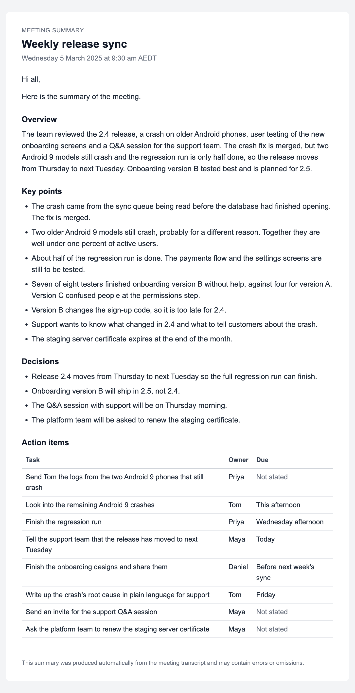
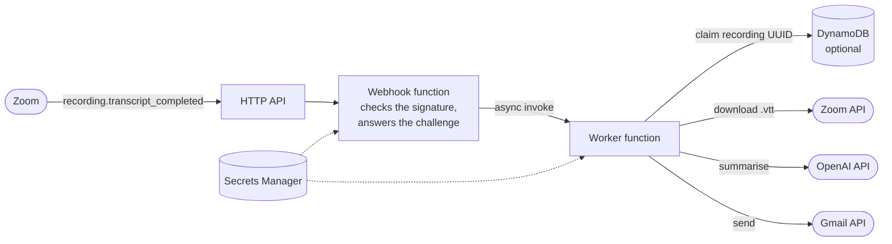

<h1 align="center">Zoom Meeting Summariser</h1>

<p align="center">
  <b>When a Zoom meeting's transcript is ready, the people on the list get a short e-mail: what was discussed, what was decided, and who agreed to do what by when.</b><br>
  Two AWS Lambda functions do the work. A webhook checks Zoom's signature and queues the event. A worker cleans the WebVTT transcript, summarises it with an OpenAI model against a strict JSON schema and sends the result through the Gmail API.
</p>

<p align="center">
  
  
  <a href="LICENSE"></a>
  <a href=".github/workflows/ci.yml"></a>
</p>

<p align="center"></p>
<p align="center"><sub><i>Illustrative layout, not real output. The HTML e-mail as the renderer draws it for <a href="examples/illustrative-summary.json">a sample summary</a> of the <a href="examples/weekly-release-sync.vtt">example transcript</a>; the sample was written to show the format and is not from a model run.</i></sub></p>

<p align="center">
  <a href="#how-it-works">How it works</a> ·
  <a href="#what-the-e-mail-contains">The e-mail</a> ·
  <a href="#try-it-locally">Try it locally</a> ·
  <a href="#deploy-to-aws">Deploy</a> ·
  <a href="#configuration">Configuration</a> ·
  <a href="#testing">Testing</a> ·
  <a href="#privacy">Privacy</a> ·
  <a href="#limitations">Limitations</a>
</p>

---

The first version ran on AWS Lambda in July 2025. This is a rework of it: the webhook now answers Zoom at once and hands the work to a second function, the summary comes back as structured JSON rather than formatted text, and the code has a test suite. The reworked version has only been tested offline. It has not been redeployed yet.

## At a glance

| Part | Detail |
|---|---|
| Trigger | Zoom's `recording.transcript_completed` webhook, sent when the audio transcript of a cloud recording is ready |
| Hosting | AWS SAM template: an HTTP API, a webhook function, a worker function and an optional DynamoDB table |
| Summary | OpenAI chat model (`gpt-4o-mini` by default) with Structured Outputs: overview, key points, decisions, and action items with owner and due date |
| Long meetings | Transcript split between speaker turns into chunks of up to 12,000 tokens by default, one request per chunk, then one request to merge them |
| Delivery | Gmail API, one message with HTML and plain-text parts, sent to the configured recipients only |
| Tests | 209 offline tests (pytest, with moto standing in for DynamoDB), plus ruff and cfn-lint in CI |

## How it works



1. Zoom posts the event to the HTTP API once a cloud recording's transcript is ready.
2. The webhook function checks the `x-zm-signature` HMAC and the request timestamp (five minutes either way) on every request, the URL-validation challenge included. It cuts a transcript event down to what the worker needs, hands that over with an asynchronous invocation and answers 200. Other events just get the 200.
3. The worker claims the recording UUID in DynamoDB and stops if the recording is already done or another attempt holds it.
4. It downloads the transcript with the event's download token (or a Server-to-Server OAuth token when there is none) and turns the WebVTT into speaker turns: cue numbers and timings go, and consecutive cues from the same speaker are joined.
5. The turns are packed into chunks of at most `CHUNK_TOKENS` tokens, breaking between turns. One chunk takes one request; more take one request each and a final merge. Every request asks for the same JSON schema.
6. The summary is rendered to HTML and plain text and sent as one message through the Gmail API. The claim is then marked done, or failed if anything raised, so that Lambda's retry can try again.

### Design notes

| Concern | How it is handled |
|---|---|
| Zoom delivers an event again if the answer is slow | The webhook only verifies and queues, so it answers straight away. The first version summarised inside the request, so a long meeting could mean a slow answer, a second delivery and a second e-mail. |
| The URL-validation challenge | Zoom's challenge asks for an HMAC of a token it sends. Answered without a signature check, it gives anyone the HMAC of any text they choose, including `v0:{timestamp}:{body}` for a request they made up, which is exactly the signature Zoom would have sent. The webhook checks the signature first. |
| Duplicates and retries | A conditional `PutItem` claims the recording when there is no item, when the last attempt failed, or when a `processing` claim's lease has run out. The lease is the time left in the invocation that made the claim. `PutItem` is the worker's only DynamoDB permission. |
| Model output | Structured Outputs in strict mode, so the reply is JSON of a known shape. A refusal, a cut-off reply or invalid JSON raises an error rather than producing a broken e-mail. Temperature is left unset, so models that only accept the default also work. |
| Text in the HTML | The topic, the greeting and every summary field are escaped, and the subject is kept to one line. |
| Network calls | Zoom: 5 s to connect, 30 s to read, 3 retries with backoff on connection errors and on 429, 500, 502, 503 and 504. OpenAI: 120 s timeout, 3 retries. Gmail: the client's 60 s timeout, 2 retries. |
| Secrets and logs | One Secrets Manager secret, read once per container and kept out of `repr()`. Logs carry event types, recording UUIDs, counts and error messages, never request bodies, tokens, transcripts or meeting titles. |

## What the e-mail contains

The subject is `Meeting summary: <topic>, <date>`. The body opens with the meeting title, its start time in `TIMEZONE` and the greeting from `EMAIL_GREETING`, followed by four sections.

| Section | Content |
|---|---|
| Overview | A few sentences on what was discussed |
| Key points | The main points, in the order they came up |
| Decisions | Only decisions the participants clearly agreed on |
| Action items | Task, owner and due date. Owners are names as they appear in the transcript, and due dates stay in the words used ("Friday", "end of March") rather than being turned into calendar dates. A missing value shows as "Not stated". |

A section with nothing in it says "None recorded." so that an empty list is not mistaken for a missing one. A grey line at the foot says the summary was produced automatically from the meeting transcript and may contain errors or omissions. The same content goes in a plain-text part for mail clients that do not show HTML.

<details>
<summary>Plain-text part of the illustrative e-mail</summary>

```text
Meeting summary: Weekly release sync
Wednesday 5 March 2025 at 9:30 am AEDT

Hi all,

Here is the summary of the meeting.

OVERVIEW
The team reviewed the 2.4 release, a crash on older Android phones, user
testing of the new onboarding screens and a Q&A session for the support
team. The crash fix is merged, but two Android 9 models still crash and the
regression run is only half done, so the release moves from Thursday to next
Tuesday. Onboarding version B tested best and is planned for 2.5.

KEY POINTS
- The crash came from the sync queue being read before the database had
  finished opening. The fix is merged.
- Two older Android 9 models still crash, probably for a different reason.
  Together they are well under one percent of active users.
- About half of the regression run is done. The payments flow and the
  settings screens are still to be tested.
- Seven of eight testers finished onboarding version B without help, against
  four for version A. Version C confused people at the permissions step.
- Version B changes the sign-up code, so it is too late for 2.4.
- Support wants to know what changed in 2.4 and what to tell customers about
  the crash.
- The staging server certificate expires at the end of the month.

DECISIONS
- Release 2.4 moves from Thursday to next Tuesday so the full regression run
  can finish.
- Onboarding version B will ship in 2.5, not 2.4.
- The Q&A session with support will be on Thursday morning.
- The platform team will be asked to renew the staging certificate.

ACTION ITEMS
- Send Tom the logs from the two Android 9 phones that still crash
  Owner: Priya. Due: Not stated.
- Look into the remaining Android 9 crashes
  Owner: Tom. Due: This afternoon.
- Finish the regression run
  Owner: Priya. Due: Wednesday afternoon.
- Tell the support team that the release has moved to next Tuesday
  Owner: Maya. Due: Today.
- Finish the onboarding designs and share them
  Owner: Daniel. Due: Before next week's sync.
- Write up the crash's root cause in plain language for support
  Owner: Tom. Due: Friday.
- Send an invite for the support Q&A session
  Owner: Maya. Due: Not stated.
- Ask the platform team to renew the staging server certificate
  Owner: Maya. Due: Not stated.

--
This summary was produced automatically from the meeting transcript and may
contain errors or omissions.
```

</details>

## Try it locally

The command-line tool runs the worker's parsing, chunking, summarising and rendering code without AWS, Zoom or Gmail. It needs Python 3.10 or later.

```bash
python -m venv .venv
source .venv/bin/activate
pip install -e .
```

A dry run parses and chunks a transcript and reports what would be sent, without an API key. The first run downloads tiktoken's `o200k_base` encoding.

```console
$ python -m meeting_summariser examples/weekly-release-sync.vtt --dry-run
Transcript:            examples/weekly-release-sync.vtt
Cues:                  40
Speaker turns:         30
Speakers:              4 (Maya, Tom, Priya, Daniel)
Tokens in the file:    1,534 (o200k_base)
Tokens after cleaning: 740
Chunks:                1 (limit 12,000 tokens each)
Model requests:        1
```

Dropping the header, cue numbers and timings, and joining consecutive cues from the same speaker, took the example from 1,534 tokens to 740. The first version sent the raw file. With `--chunk-tokens 500` the same transcript splits into 2 chunks and needs 3 requests.

To summarise it for real, set an OpenAI API key:

```bash
export OPENAI_API_KEY=...
python -m meeting_summariser examples/weekly-release-sync.vtt --html summary.html --json summary.json
```

Without `--html` or `--text`, the plain-text e-mail is printed. `--model`, `--chunk-tokens`, `--topic`, `--start` and `--timezone` override the defaults. To see the layout without calling any API, render the sample summary:

```bash
python -m meeting_summariser --from-summary examples/illustrative-summary.json \
  --topic "Weekly release sync" --start 2025-03-04T22:30:00Z \
  --timezone Australia/Sydney --html layout.html
```

## Deploy to AWS

You need an AWS account with the AWS CLI, the SAM CLI and Docker, a Zoom account with cloud recording and audio transcripts turned on (Zoom only sends the event for cloud recordings), a Google account to send from and an OpenAI API key.

### 1. Create the Zoom app

In the Zoom App Marketplace, create an app for your account that can subscribe to events. A Server-to-Server OAuth app works and also supplies the optional OAuth credentials, which are only used when an event arrives without a download token (they need a scope that can read cloud recordings). Turn on event subscriptions, add the `recording.transcript_completed` event and copy the app's secret token. The endpoint URL comes in step 5.

### 2. Create the Gmail token

In Google Cloud, create a project, enable the Gmail API, set up the OAuth consent screen and create an OAuth client ID of type "Desktop app". Download its JSON file, then run:

```bash
pip install -e ".[gmail-setup]"
python scripts/create_gmail_token.py --client-secrets path/to/client_secret.json
```

A browser window asks you to sign in with the account that will send the summaries and to allow it to send e-mail. The only scope requested is `gmail.send`. The token is saved to `.auth/gmail_token.json`, which git ignores. Google expires refresh tokens early for apps left in Testing status, so publish the consent screen, or use an internal Google Workspace app, before relying on the token.

### 3. Store the secrets

`python scripts/create_gmail_token.py --print-secret-shape` prints the shape of the secret:

```json
{
  "ZOOM_WEBHOOK_SECRET": "<secret token from the Zoom app>",
  "OPENAI_API_KEY": "<OpenAI API key>",
  "GMAIL_TOKEN_JSON": {
    "token": "<access token>",
    "refresh_token": "<refresh token>",
    "token_uri": "https://oauth2.googleapis.com/token",
    "client_id": "<OAuth client ID>",
    "client_secret": "<OAuth client secret>",
    "scopes": [
      "https://www.googleapis.com/auth/gmail.send"
    ]
  },
  "ZOOM_CLIENT_ID": "<optional: Server-to-Server OAuth client ID>",
  "ZOOM_CLIENT_SECRET": "<optional: Server-to-Server OAuth client secret>",
  "ZOOM_ACCOUNT_ID": "<optional: Zoom account ID>"
}
```

Write the real values to `.auth/secret.json`, pasting the whole of `.auth/gmail_token.json` as the value of `GMAIL_TOKEN_JSON` (a string holding the same JSON also works), and create the secret:

```bash
aws secretsmanager create-secret --name meeting-summariser \
  --secret-string file://.auth/secret.json
```

Note the ARN it prints, then delete `.auth/secret.json`. If the secret is encrypted with a customer-managed KMS key, both functions also need `kms:Decrypt` on that key.

### 4. Build and deploy

```bash
sam build --use-container
sam deploy --guided
```

`--use-container` builds the bundle in a Lambda-like container, so the compiled packages (tiktoken, and pydantic-core and jiter under the OpenAI client) match the arm64 runtime. The guided deploy asks for a stack name (`meeting-summariser`, say), `SecretArn`, `EmailTo` and the optional parameters (`EmailFrom`, `EmailGreeting`, `TimeZone`, `OpenAIModel`, `ChunkTokens`, `EnableDedupe`). It saves the answers in `samconfig.toml`, which git ignores because it holds the recipients and the secret's ARN. At the end it prints `WebhookUrl`.

### 5. Point Zoom at the webhook

Paste `WebhookUrl` into the app's event notification endpoint URL and press Validate. Zoom sends `endpoint.url_validation`, and the webhook checks the signature and answers it. Then activate the app.

### 6. Check it

Record a short test meeting to the cloud. Once Zoom has processed the transcript, the e-mail arrives. The worker's logs are in CloudWatch:

```bash
sam logs --stack-name meeting-summariser --name WorkerFunction --tail
```

## Configuration

The template sets these environment variables.

| Variable | Used by | Default | Meaning |
|---|---|---|---|
| `SECRET_ID` | both | none | Secrets Manager secret name or ARN. Without it, the secret keys are read from environment variables of the same names, as in the CLI. |
| `WORKER_FUNCTION_NAME` | webhook | none | The worker function to invoke |
| `EMAIL_TO` | worker | none | Comma-separated recipients, as `a@example.com` or `Name <a@example.com>` |
| `EMAIL_FROM` | worker | the Gmail account | From header; Gmail replaces it unless it is the account's own address or one of its send-as aliases |
| `EMAIL_GREETING` | worker | `Hi all,` | First line of the e-mail |
| `TIMEZONE` | worker | `UTC` | IANA time zone for the meeting date, for example `Australia/Sydney` |
| `OPENAI_MODEL` | worker | `gpt-4o-mini` | Chat model; it must support Structured Outputs |
| `CHUNK_TOKENS` | worker | `12000` | Largest chunk in tokens, at least 500 |
| `DEDUPE_TABLE` | worker | not set | DynamoDB table for the once-only check; without it, every delivery is processed |
| `LOG_LEVEL` | both | `INFO` | Python logging level |
| `TIKTOKEN_CACHE_DIR` | worker | tiktoken's default | Where tiktoken caches its encoding; the template uses `/tmp/tiktoken` |

The secret holds these keys.

| Key | Required | Purpose |
|---|---|---|
| `ZOOM_WEBHOOK_SECRET` | yes | The Zoom app's secret token, used to check signatures and answer the challenge |
| `OPENAI_API_KEY` | yes | OpenAI API key |
| `GMAIL_TOKEN_JSON` | yes | The token from `scripts/create_gmail_token.py`, as a JSON object or a string |
| `ZOOM_CLIENT_ID`, `ZOOM_CLIENT_SECRET`, `ZOOM_ACCOUNT_ID` | no | Server-to-Server OAuth, used only when an event has no download token |

The webhook's role can read the secret and invoke the worker. The worker's role can read the secret and, when the table exists, put items in it. Both roles also have `AWSLambdaBasicExecutionRole` for writing logs.

## Testing

```bash
pip install -e ".[dev]"
pytest
ruff check . && ruff format --check .
cfn-lint template.yaml    # pip install cfn-lint
```

The 209 tests run offline. Zoom, OpenAI and Gmail are replaced by small fakes, and DynamoDB by moto, so the once-only check runs against real conditional-write behaviour.

| Area | What the tests check |
|---|---|
| Webhook | Valid and invalid signatures (wrong secret, changed body, stale or future timestamp, missing `v0=` prefix); the challenge answer, and its refusal when unsigned; the asynchronous hand-off and its trimmed payload; a 500 when the hand-off fails; logs free of tokens and personal details |
| Worker | Claim, done and failed paths; one e-mail for two deliveries of the same event |
| Transcripts and chunking | Cue numbers, timings and NOTE or STYLE blocks dropped; turns joined; voice tags and entities; the token limit held, with long turns split between words |
| Summary | One request, or parts and a merge; the strict schema; refusals, cut-off replies and invalid JSON |
| E-mail | Every field escaped; empty sections; time zones; the exact plain-text layout; the multipart message |
| Configuration | Defaults, validation, secrets kept out of `repr()`, Secrets Manager read once |

CI runs the same checks on Python 3.12 for every push and pull request.

## Privacy

- The transcript goes to OpenAI's API to be summarised. It holds the participants' names and what they said. Tell people their meetings are summarised this way, get consent where it is needed, and check your organisation's rules before turning it on. OpenAI's API data policy applies to what it receives.
- The e-mail goes only to the addresses in `EMAIL_TO`. Participants do not get it unless they are on that list.
- The project stores no transcript or summary. Both exist only in the worker's memory while it runs. The DynamoDB table holds a recording UUID, a status and timestamps, and its TTL removes each item after seven days.
- The webhook passes the worker only the fields it needs, so the host's e-mail address and the recording passcode in Zoom's event go no further.
- Logs record event types, recording UUIDs, counts and error messages, not request bodies, tokens, transcripts, meeting titles or summaries.

## Repository contents

| Path | What it is |
|---|---|
| [`src/meeting_summariser/handlers.py`](src/meeting_summariser/handlers.py) | Lambda entry points for the webhook and the worker |
| [`src/meeting_summariser/pipeline.py`](src/meeting_summariser/pipeline.py) | The job passed between the functions; download, summarise, render and send |
| [`src/meeting_summariser/zoom.py`](src/meeting_summariser/zoom.py) | Signature check, URL validation, transcript download, OAuth token |
| [`src/meeting_summariser/transcript.py`](src/meeting_summariser/transcript.py) | WebVTT parsing into speaker turns |
| [`src/meeting_summariser/summarise.py`](src/meeting_summariser/summarise.py) | Chunking, prompts, the JSON schema and the OpenAI requests |
| [`src/meeting_summariser/render.py`](src/meeting_summariser/render.py) | HTML and plain-text bodies |
| [`src/meeting_summariser/mailer.py`](src/meeting_summariser/mailer.py) | Gmail API sender |
| [`src/meeting_summariser/dedupe.py`](src/meeting_summariser/dedupe.py) | DynamoDB once-only check |
| [`src/meeting_summariser/config.py`](src/meeting_summariser/config.py) | Settings from the environment and Secrets Manager |
| [`src/meeting_summariser/cli.py`](src/meeting_summariser/cli.py) | Local command line (`python -m meeting_summariser`) |
| [`src/requirements.txt`](src/requirements.txt) | Packages for the Lambda bundle, pinned to the versions the tests ran with |
| [`template.yaml`](template.yaml) | SAM template |
| [`scripts/create_gmail_token.py`](scripts/create_gmail_token.py) | One-off Gmail OAuth token helper |
| [`examples/weekly-release-sync.vtt`](examples/weekly-release-sync.vtt) | Synthetic transcript with fictional people |
| [`examples/illustrative-summary.json`](examples/illustrative-summary.json) | Sample summary used for the layout image, written to show the format; not output from a model run |
| [`docs/images/email-layout.png`](docs/images/email-layout.png) | The layout image |
| [`tests/`](tests) | Test suite |
| [`pyproject.toml`](pyproject.toml) | Package metadata and the ruff and pytest settings |
| [`.github/workflows/ci.yml`](.github/workflows/ci.yml) | CI |

## Changes from the first version

The first version was two files, `lambda_function.py` and `pipeline.py`, deployed as one Lambda function.

| First version | This version |
|---|---|
| Summarised inside the webhook request, so a long meeting could make Zoom deliver the event again and send a second e-mail | The webhook answers at once, the worker runs asynchronously, and the DynamoDB check sends one e-mail per recording |
| Answered the URL-validation challenge without checking the signature | Every request is checked first |
| Logged the full webhook event and the names of the secret's keys | Logs hold event types, recording UUIDs, counts and error messages |
| Greeted a named person in every e-mail | `EMAIL_GREETING` |
| Parsed the model's formatted text line by line and inserted it into HTML unescaped | Strict JSON schema, rendered from the structure, every value escaped |
| Sent the raw WebVTT, cut at fixed token offsets, and asked for up to 6,000 words per slice | Cleaned speaker turns, split between turns, with a short fixed structure for the summary |
| No timeouts or retries on HTTP calls | Timeouts and retries on every Zoom, OpenAI and Gmail call |
| Asked for `openai>=0.27` while calling the v1 API; listed `cryptography`, which it no longer used | `openai>=1.40`, pinned versions for the bundle |
| No tests | 209 offline tests, with ruff and cfn-lint in CI |

## Limitations

- This version has not been redeployed. The tests replace Zoom, OpenAI, Gmail and AWS with fakes, so its behaviour against the live services is unproven. For example, it sends the download token in an `Authorization` header, where the first version passed it as a query parameter.
- Summary quality has not been evaluated, and errors in Zoom's speech recognition carry through into the summary.
- The merge step sends every partial summary in one request, so a very long transcript with many chunks would need another level of merging.
- Speakers are found from `Name:` prefixes or WebVTT voice tags. In a transcript without speakers, text before a colon at the start of a cue can be read as a name.
- The once-only check is keyed on the meeting's UUID, so if Zoom produces a new transcript for the same meeting within seven days, it is skipped.
- tiktoken downloads its encoding the first time a new worker container counts tokens.
- The model must support Structured Outputs. Each meeting costs OpenAI tokens, and nothing caps the spend.

## Licence

MIT. See [LICENSE](LICENSE).
